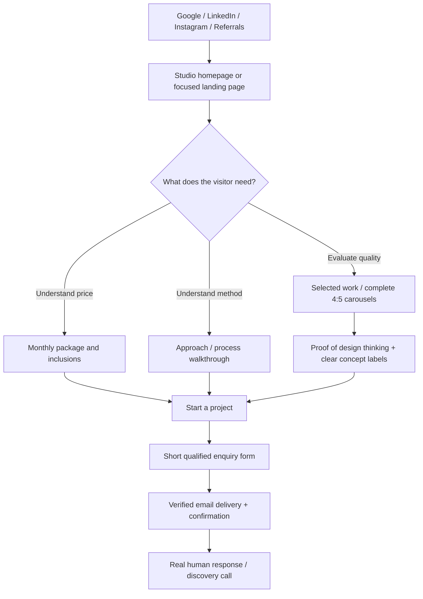

# SLIDECRAFT STUDIO — SUBDOMAIN, PREMIUM WEBSITE & CLIENT ACQUISITION IMPLEMENTATION PLAN

**Prepared:** 7 November 2026  
**Website:** `https://slidecraft.gopaldev.in` (proposed, not yet provisioned)  
**Parent portfolio:** `https://gopaldev.in` (leave unchanged)  
**Business:** Slidecraft Studio, an independent creative studio focused on premium LinkedIn/Instagram carousel content.  
**Primary outcome:** Qualified paying monthly clients, starting at **₹10,000/month**.

> This is a build plan, not a claim that any DNS record has been changed, the studio site deployed, its form configured, or its Lighthouse scores tested. It is tailored to the Slidecraft Next.js starter already produced in this conversation. Preserve truthful labeling of all six portfolio examples as self-initiated concepts.

---

## 01 — The decision: one portfolio, one studio subdomain

| Property | URL | Purpose | Positioning |
|---|---|---|---|
| Personal site | `gopaldev.in` | Developer identity, engineering portfolio, technical work | Individual engineer |
| Creative studio | **`slidecraft.gopaldev.in`** | Carousel work, monthly packages, client enquiries | Slidecraft Studio brand |
| Possible long-term standalone site | `slidecraftstudio.in` (availability to be checked) | An independent, brand-owned domain if commercially justified | Studio-first identity |

**Why `slidecraft.gopaldev.in`:** recognizably branded, specific, easy to put on business profiles, and uses an already-owned parent domain. Alternative: `studio.gopaldev.in` is shorter but less distinctive. Avoid `agency.gopaldev.in`, `services.gopaldev.in`, or `marketing.gopaldev.in` because they obscure the carousel specialization.

**Brand separation:** The personal portfolio should remain the engineering hub. Add a tasteful single link there—**“Creative venture · Slidecraft Studio”**—rather than replacing personal case studies with studio work. The studio may mention “Founded by an independent designer/developer” if true; do not falsely claim an agency team or clients. Cross-link meaningfully, without copying identical pages.

**SEO realism:** A subdomain can be crawled and indexed, but it does **not automatically inherit** all ranking strength from the parent domain. Build studio-specific authority, case studies, useful content, and external referrals. A standalone domain can be considered later, but a domain migration requires redirects, canonical changes, and Search Console monitoring.

---

## 02 — Recommended architecture and deployment

```text
gopaldev.in (existing personal portfolio)
    └── Personal portfolio deployment / repository  — remains untouched

slidecraft.gopaldev.in (new commercial website)
    ├── Separate GitHub repo: slidecraft-studio
    ├── Separate Next.js App Router deployment
    ├── Static/SSR landing, services, project & article pages
    ├── Small client islands: nav, filters, slide viewer, form, approach demo
    ├── /api/contact → validated enquiry → transactional email provider
    └── Search Console + analytics + performance monitoring

DNS zone for gopaldev.in
    └── 'slidecraft' CNAME → target supplied by hosting platform
```

**Tech choices**
- Frontend: **Next.js App Router, React, TypeScript, semantic HTML and CSS**. Reuse the existing Slidecraft starter to reduce work.
- Design system: CSS custom properties, component-scoped styles, Space Grotesk + Inter/Geist with `next/font`.
- Motion: **CSS transforms/opacity by default**; use IntersectionObserver for deliberate one-time reveals; a motion library only where it offers a meaningful improvement.
- Portfolio: typed local data (`lib/projects.ts`) and static route generation. No CMS or database is needed for six curated concept projects.
- Enquiries: server-side API route with schema validation, rate limiting/anti-spam, Resend or another actual email provider. Do not report success if the provider failed.
- Analytics: privacy-conscious analytics + Google Search Console; track conversions only after reviewing consent/privacy requirements.
- Media: original art-directed SVG/HTML/CSS slide compositions or optimized original images. Consider Cloudflare R2 only if assets later become numerous; not a launch dependency.
- Hosting: Vercel **Pro** for a commercial Vercel deployment, or another hosting provider whose terms permit business use. Vercel Hobby is restricted to personal, non-commercial use (checked November 2026). Confirm any final price/usage at purchase time.

**Avoid at launch:** auth, a customer portal, CRM-heavy integrations, artificial chatbot widgets, auto-playing video backgrounds, a paid CMS, heavyweight animation libraries, or a database solely to serve static portfolio content. These add complexity without improving initial conversions.

### Existing starter: files to update rather than rewrite

The previously supplied `slidecraft-studio-nextjs.zip` has the main structure. Specifically inspect:

- `lib/site.ts`: `NEXT_PUBLIC_SITE_URL` → `https://slidecraft.gopaldev.in`; brand and contact data.
- `app/layout.tsx`: metadata, canonical base, OG data, JSON-LD, global fonts, nav/footer.
- `app/page.tsx`: the new visual direction and sections.
- `app/globals.css`: motion tokens, responsive grid, reduced motion.
- `components/navbar.tsx`: scroll compactness and keyboard-accessible mobile navigation.
- `components/carousel-artwork.tsx`: hero visuals and design system.
- `components/portfolio-grid.tsx`: filters and hover states.
- `components/project-viewer.tsx`: 4:5 viewing, keyboard arrows, touch, counters and accessibility.
- `lib/projects.ts`: six concepts, slide content, categories and design directions.
- `app/work/[slug]/page.tsx`: complete project stories and CTA.
- `app/services/carousel-design/page.tsx`: the principal keyword/service landing page.
- `app/sitemap.ts`, `app/robots.ts`, `app/opengraph-image.tsx`: search and sharing.
- `components/contact-form.tsx`, `app/api/contact/route.ts`: actual email delivery + spam prevention.
- `.env.example`: updated deployment values.

---

## 03 — Conversion strategy (the actual business goal)

**Target customer:** founders and marketers at SaaS/technology companies, B2B firms, agencies, personal brands, coaches and consultants. Prioritize buyers who need a repeatable content system over visitors who simply enjoy pretty visuals.

**Primary offer: “Monthly Carousel Content” — from ₹10,000/month.** Include exactly:
1. 8 carousels per month.
2. 6–8 slides per carousel.
3. Research and content structure.
4. Hooks and slide copywriting.
5. Premium visual design.
6. Captions.
7. Two revision rounds per carousel.

Additional services can be quoted separately: static social graphics, LinkedIn branding graphics, brand templates, short-form editing and content calendars. Do not make up prices for add-ons. Spell out operational details before contract (briefing, turnaround, approvals, scope boundaries, delivery format, usage rights, invoicing, refunds).

**Visitor journey:**



**Navigation:** Work · Services · Approach · Pricing · About · **Let's Talk**. The CTA should remain easy to reach on mobile. Keep only one major accent CTA in each viewport.

**Trust without fabricated social proof:** Show complete process examples, before/after design explanations, service scope, founder identity if accurate, contact details, original content and real project constraints. Until actual clients approve publication, every example must be visibly marked **“Self-initiated concept project.”** Never add fictional testimonials, logos, conversion metrics, ratings or team bios.

---

## 04 — Visual brand and design system

**Creative direction:** premium editorial design studio x contemporary SaaS polish. Bold type, clean grid, warm off-white, deliberate asymmetry and carousel designs as the artwork.

| Token | Value | Use |
|---|---|---|
| Canvas | `#F7F7F2` | Background |
| Ink | `#151619` | Primary text and dark sections |
| Electric blue | `#5365F8` | CTAs, details and SaaS art |
| Lime | `#C8EF78` | Sparing highlights, meaningful accents |
| Supporting text | `#777777` | Descriptions |
| Dividers | `#E4E3DD` | Grid lines and borders |
| Display font | Space Grotesk | Headlines, selected numerals |
| Body font | Inter or Geist | Body, forms, labels |
| Card radius | 16–20px | Visual projects/service cards |
| Main layout | 12-column grid; ~1200–1320px content max | High-quality hierarchy |
| Spacing | Responsive 8px-derived scale | Rhythm between sections |

**Typography guideline:** Display heading `clamp(3rem, 6.5vw, 6.75rem)`, body 16–18px, generous line-height, readable paragraph measure (~60–75 characters), intentional uppercase eyebrows. Ensure no clipped hero words or horizontal scrolling at 320px.

**Visual signature:** Original 4:5 carousel slides consistently appear in the hero, selected work, case studies and relevant CTAs. No generic photos, random gradient orbs, fake glass UI, excessive shadows or trendy decorations unrelated to the service.

---

## 05 — Complete page and section specification

### A. Landing page (`/`)

**01. Sticky header**: text wordmark left; Work / Services / Approach / About; prominent “Let's Talk” right. Desktop header shrinks subtly *within a stable-height shell* after scroll; blur is subtle. Mobile: fully accessible popover/drawer with close, focus and keyboard Escape.

**02. Hero**: eyebrow `INDEPENDENT CAROUSEL DESIGN STUDIO`; H1 **“Make your ideas impossible to scroll past.”**; intro **“We turn ideas, expertise and products into premium social media content that captures attention, communicates value and makes your brand memorable.”** CTA **Explore Our Work**, secondary **Start a Project**, line **“Monthly content packages starting at ₹10,000.”** On the right: three *original* overlapping 4:5 preview cards (SaaS dark navy/blue, editorial founder cream, minimal educational). Use subtle float only, not a video.

**03. Value proposition strip**: a concise line “Research. Story. Design. Delivered consistently.” Avoid unverified logos or ‘trusted by 100+ brands’ claims.

**04. Selected work**: headline **“Design that communicates.”** Grid of six original concept projects, desktop bento-like (2 prominent, 4 balanced), mobile one-column. Clear category labels and “Concept” attribution. Every item links to a stable detail URL. Filters: All / SaaS & Technology / Founder Branding / Education / Marketing / Business & Case Studies. Add clear/empty state for combinations.

**05. Signature approach (interactive, memorable section)**: headline **“From scattered ideas to stories worth saving.”** Use a 4-state visual storyline with a sticky 4:5 preview next to short numbered steps. See motion storyboard in section 06.

**06. Services**: four cards, primary Carousel Design visually featured; Content Writing; Brand & Social Graphics; Short-form Motion Content. Each indicates deliverables and next action; secondary service cards must not visually overpower the main offer.

**07. Monthly package**: price from ₹10,000/month, 8 carousels, 6–8 slides, research, writing, premium design, captions, 2 revision rounds. Add `Request a Monthly Plan` CTA. Mark additional services as separately quoted. Include transparent FAQs on revision scope and onboarding rather than inventing deadlines.

**08. Process / delivery**: Discover → Strategize → Create → Refine & Deliver. Each shows what the studio does and the client input/approval required. This can complement but should not duplicate the visual “Approach” interactive block.

**09. About**: small genuine studio story, aesthetic viewpoint, operating philosophy, who is behind the work if true, why founders work with the studio. Avoid generic agency stock portraits or team claims.

**10. Insights**: 2–3 original useful articles targeted to buyers; cards and internal links.

**11. FAQ**: What exactly is included? Can I provide a brand kit? What platforms are covered? How do revisions work? Can I order one-off work? What is not included? How do we start? Be careful not to promise unagreed timeframes.

**12. Contact**: headline **“Let's make your next scroll stop.”** Form fields: name, business email, company/brand, service needed, brief, optional budget/timeline. Show direct email only once configured. Real loading, success and error states.

**13. Footer**: brand, short positioning statement, Work / Service / Insights / Contact / Privacy, tasteful link back to developer portfolio if desirable.

### B. Work gallery (`/work`)
- Every card has original thumbnail, name, category, mini creative brief, slide count, “Concept project” label.
- Keyboard accessible filters; changing selection doesn't silently re-order the entire page beyond the filter action.
- First load shows all six; images sized or pure CSS slide compositions to prevent CLS.

### C. Dedicated project routes (`/work/[slug]`)

Each project includes **title, category, clear concept label, objective, intended audience, content angle, visual strategy, palette, complete slide-by-slide high-resolution 4:5 viewer, count, prev/next, touch and keyboard navigation**, and a CTA “Want something similar for your brand? Let's Talk.” Shareable URL, unique title/description/OG.

Six original concepts, **7 slides each = 42 original slides**:

| Project | Content narrative | Visual approach |
|---|---|---|
| SaaS Growth Playbook | How product-led companies create repeatable growth | Dark navy, blue highlights, bold metrics-as-graphics (no fabricated business data) |
| Founder Lessons | Building, learning and refining founder judgment | Warm cream, editorial headlines, margin notes |
| The Future of AI | Clear, thoughtful explanation of practical AI adoption | Tight modular grid, high contrast, abstract functional diagrams |
| Marketing Mistakes | Common content and positioning mistakes with practical fixes | Strong contrasting typography, memorable correction layouts |
| Startup Product Strategy | Problem discovery → positioning → product priorities | Clean frameworks, blue/lime strategic diagrams |
| Business Case Study | Hypothetical problem → strategy → illustrated outcome | Data-informed-looking but clearly fictional examples; no claimed real metrics |

### D. Main service page (`/services/carousel-design`)

An indexable, buyer-friendly landing page for **LinkedIn & Instagram carousel design**. Address who it is for, examples, the month-to-month process, actual inclusions, pricing starting point, FAQs, work links and enquiry. Do **not** duplicate homepage hero verbatim.

### E. Insight articles (`/insights/[slug]`)

Initial editorial topics to research and write originally:
- “How to brief a LinkedIn carousel designer for a B2B brand”
- “What eight carousels per month can look like for a SaaS founder”
- “Carousel storytelling: hooks, narrative progression and closing slides”
- “LinkedIn vs Instagram carousel design: what should change?”

Use practical examples, source claims that require evidence, and internal links to the service and matching projects. Quality matters more than artificial publication frequency.

### F. Optional later pages, not required at launch

`/pricing` if standalone price discovery becomes a major traffic path; `/contact` if separate contact landing is needed for ads; `/terms` once contract policy is finalized; real client case studies only with approval. Avoid bloating the initial site.

---

## 06 — Premium animation specification and storyboard

**Animation art direction:** calm, deliberate, interactive and informative. People should remember the work rather than the effects. Motion shouldn't slow the first render, hijack scroll or block clicking.

### Motion token system

| Effect | Desktop duration | Movement | Trigger | Mobile / reduced-motion behavior |
|---|---|---|---|---|
| Navbar underline | 180–240ms | scaleX 0 → 1 | Hover / focus | Keep focus indicator |
| Hero reveal | 480–650ms | opacity + translateY(18px) | First render | Shorter; fully visible for reduced motion |
| Hero art stagger | 400–550ms/card | translateY(16px) → 0 | First render | All cards positioned visibly |
| Gentle float | 7–10s per cycle | translateY(4–7px) | Only while hero is visible | Disable on mobile and reduced motion |
| Work card hover | 240–360ms | translateY(-6px), thumbnail scale(1.02) | Hover/focus | No hover dependency |
| Section intro reveal | 350–550ms | opacity + translateY(12–20px) | First intersection | Instant when reduced motion |
| Pricing CTA | 180–230ms | subtle arrow shift | Hover/focus | Static icon for reduced motion |
| Gallery filter | 180–280ms | crossfade or simple transition | User click | Immediate content where needed |
| Slide viewer | 250–350ms | horizontal translation | User controls/swipe | Instant for reduced motion |

**Only animate `transform` and `opacity` by default.** Avoid `filter: blur()` on large scroll regions, video backgrounds, large animated box-shadows and scroll-bound layout properties. Use `will-change` sparingly and only during the animation. Ensure offscreen components can be lazy-loaded if actually heavy.

### Signature animated **APPROACH** section — full interaction design

**Title:** “Your idea. A story. A carousel people remember.”  
**Subtitle:** “A repeatable creative process that turns raw expertise into clear, visual storytelling.”

Desktop composition:

```text
┌───────────────────────────────────────────────────────────────────┐
│  OUR APPROACH                                                    │
│  From scattered ideas to stories worth saving.                  │
│                                                                   │
│  LEFT: narrative steps                   RIGHT: sticky 4:5 slide │
│  01 Discover   ■ active                  ┌────────────────────┐  │
│     Your goal, audience, voice           │ IDEA / NOTES        │  │
│  02 Structure                            │ a raw content brief │  │
│     Hook + story sequence                │ and 3 rough points  │  │
│  03 Design                               └────────────────────┘  │
│     Type, hierarchy, diagrams            01 / 04                 │
│  04 Deliver                                                       │
│     Consistent brand-ready assets                                 │
└───────────────────────────────────────────────────────────────────┘
```

**State 01 — Discover:** A clean “raw idea” slide: short typed notes, audience label, brief. One note gently highlights; no fake keystroke/autotyping required.

**State 02 — Structure:** The same idea is reorganized into a 7-slide content outline. Thin line transitions reveal: Hook → Context → Insight → Example → Framework → Takeaway → CTA. No words fly around the screen.

**State 03 — Design:** The outline becomes a full branded 4:5 carousel cover with original graphic design, clear typography and a disciplined palette. Animate with opacity/crossfade and short translate, not an expensive 3D flip.

**State 04 — Deliver:** Show a neat, small 3-card fan of finalized social slides and a concise “8 carousels per month” reminder. CTA: **“Get your monthly carousel plan.”**

**How to implement:**
- Desktop: two-column layout; a controlled sticky preview on the right and actual readable steps on the left. Use IntersectionObserver on each visible step to update the preview. Do not trap the scroll.
- Each step is also a real accessible button/tab; clicking directly selects it (users shouldn't have to scroll through animation).
- Mobile: disable sticky, show a selected state with horizontal step control or stacked sequence. Preserve a 4:5 visual ratio; no endless scrolling.
- Keyboard: tab to steps, activate with Enter/Space. Expose selected state via `aria-current` or tab semantics as appropriate.
- Loading/JS failure: show the first complete visual and full process text. Never render content invisible without JS.
- Reduced motion: instant previews; no floating/translation; interactions still function.
- Analytics: optional `approach_step_view` only if useful for conversion measurement; do not track noisy scroll events by default.

### Example CSS motion starter

```css
:root {
  --motion-fast: 220ms;
  --motion-medium: 380ms;
  --motion-long: 600ms;
  --ease-editorial: cubic-bezier(.22, 1, .36, 1);
}

.project-card {
  transition: transform var(--motion-medium) var(--ease-editorial);
}
.project-card:is(:hover, :focus-within) {
  transform: translateY(-6px);
}
.hero-preview--floating {
  animation: gentle-float 8s ease-in-out infinite;
}
@keyframes gentle-float {
  0%, 100% { transform: translateY(0); }
  50% { transform: translateY(-6px); }
}
@media (max-width: 767px), (prefers-reduced-motion: reduce) {
  .hero-preview--floating { animation: none; }
}
@media (prefers-reduced-motion: reduce) {
  *, *::before, *::after {
    scroll-behavior: auto !important;
    animation-duration: .01ms !important;
    animation-iteration-count: 1 !important;
    transition-duration: .01ms !important;
  }
}
```

**Caution:** If an element already has an entrance transform or rotation, don't apply the float transform to that same element; float a nested wrapper to avoid transform collisions.

---

## 07 — Technical SEO, discoverability and social preview

**Canonical domain:** Every canonical URL, metadata base, schema URL and sitemap entry must use `https://slidecraft.gopaldev.in` in production. Never ship `localhost`, `your-real-domain.com` or a Vercel preview URL as a production canonical.

**Routes and search intent**

| URL | Suggested main title | Search intent |
|---|---|---|
| `/` | Slidecraft Studio — Premium Carousel Design for Founders & Brands | Brand discovery |
| `/services/carousel-design` | LinkedIn & Instagram Carousel Design Services | Service / commercial |
| `/work` | Carousel Design Portfolio — Slidecraft Studio | Design quality |
| `/work/saas-growth-playbook` | SaaS Growth Playbook — Carousel Concept | Relevant work example |
| `/insights/...` | Descriptive article-specific title | Informational |

**Build checklist**
- Unique title, meta description, H1, OG image, canonical and visible content on every indexable page.
- Generate metadata server-side with Next.js `metadata` / `generateMetadata`.
- Generate `app/sitemap.ts` and `app/robots.ts`; test actual deployed outputs.
- Use descriptive URLs, semantic HTML and accessible image descriptions.
- Use truthful `Organization` or `ProfessionalService`/`Service` schema where appropriate, and `CreativeWork`/`Article` on relevant pages. Don't pretend concept projects are paid assignments or mark up nonexistent ratings.
- **Noindex** preview/staging deployments where practical, and avoid duplicate production domain content.
- Verify `gopaldev.in` as a **Domain property** in Google Search Console (covers its subdomains); additionally create a **URL-prefix property** for `https://slidecraft.gopaldev.in/` for an easier studio-only view.
- Submit `https://slidecraft.gopaldev.in/sitemap.xml`, inspect homepage/service/project pages and watch indexing. Search Console submission does not guarantee indexing.
- Create beautiful original 1200×630 OG visuals and share previews on LinkedIn/WhatsApp. Ensure all OG text is legible at thumbnail size.
- Use real original case-study content and helpful guides; avoid keyword stuffing or mass-produced near-duplicate articles.

**Suggested long-term keyword clusters:** LinkedIn carousel designer, carousel design services for SaaS, Instagram carousel design for coaches, B2B LinkedIn content design, monthly carousel content packages, carousel designer pricing in India. Research actual demand and competitiveness with Search Console and keyword research tools; these are topic ideas, not measured search-volume claims.

**Organic acquisition loop**

1. Publish a genuine practical article or useful carousel concept.
2. Repurpose it into a LinkedIn/Instagram carousel on the studio/personal channels with a relevant project or article link.
3. Invite interested founders to view the complete case study.
4. Show transparent pricing/scope, then a short project enquiry.
5. Track source → enquiry → qualified lead → paid client; optimize for actual outcomes.

---

## 08 — Performance and accessibility definition of done

Target **excellent** Lighthouse scores across Performance, Accessibility, Best Practices and SEO; 100/100 is an aspiration, *not* something any plan can promise. Audit the deployed production site under reproducible mobile and desktop conditions.

**Field Core Web Vitals targets (75th percentile):** LCP ≤2.5 seconds; INP ≤200 milliseconds; CLS ≤0.1.

**Engineering priorities**
- Server Components for content; client components only for actual interactions.
- No large Lottie bundles/video backgrounds in the hero. Avoid carousels that automatically advance without user action.
- Optimize above-the-fold assets, use appropriate formats/dimensions; keep the primary hero visual high priority.
- Lazy-load offscreen slides and insights imagery; keep project art stable with `aspect-ratio: 4 / 5`.
- Use Next font optimization, sensible weights/subsets and `font-display: swap`.
- Avoid unnecessary third-party scripts, tag managers and large cookie managers.
- Prevent layout shifts from sticky nav, expanding FAQ, images, web fonts and animation wrappers.
- Verify responsive widths at 320, 375, 390, 768, 1024, 1280 and 1440px.
- Ensure text contrast, keyboard-only flows, visible focus rings, landmarks, labels, alt/aria text, no hover-only content, mobile touch targets.
- Honor `prefers-reduced-motion` across every animated component.

**Testing matrix:**

| Page / interaction | Check |
|---|---|
| Homepage | LCP/CLS, hero animations, CTAs, mobile layout, accessible nav |
| `/work` | filters, keyboard operation, empty states |
| All six `/work/[slug]` | images, seven slides, 4:5 ratio, swipe, arrows, counts, direct links |
| Service page | real content, internal linking, pricing, contact |
| Article pages | unique metadata, correct canonical, readability |
| Contact form | validation, anti-spam, legitimate success/failure, email delivery |
| Indexing | `robots.txt`, sitemap, canonical, OG image, JSON-LD |
| Browsers | Chrome, Safari/iOS, Firefox/Edge, slow mobile profile |

**Tooling:** Lighthouse CLI or PageSpeed Insights, Search Console Core Web Vitals, accessibility tooling plus human keyboard/screen-reader checks. Record scores/date/test URL in a release checklist; don't report an unrun audit as 100.

---

## 09 — Lead capture, email and privacy

**Form:** name, professional email, brand/company, requested service, one free-text question; optional budget/timeline. Keep it intentionally short and mobile-friendly.

**Submission flow:** frontend schema/field errors → POST API → strict server validation → rate limit / honeypot / optionally Turnstile → Resend or other provider → delivery-status response → accessible thank-you + expected reply policy **only if the business can actually meet it**.

**Security:** no API key client-side; use `RESEND_API_KEY` in server-only environment variables. Escape submitted text in generated emails; prevent header injection, limit payload size, implement durable rate limits for serverless deployments, add basic bot controls, never log sensitive brief content in full.

**Suggested production configuration**

```env
NEXT_PUBLIC_SITE_URL=https://slidecraft.gopaldev.in
NEXT_PUBLIC_CONTACT_EMAIL=hello@gopaldev.in
RESEND_API_KEY=<server-only secret>
CONTACT_FROM_EMAIL=Slidecraft Studio <hello@your-verified-sending-domain>
CONTACT_TO_EMAIL=<your real receiving email>
```

`hello@gopaldev.in` is an *example*, not an address known to exist. Choose a mailbox you actually own and monitor. Verify whichever sending domain you choose with the provider's required DNS records (SPF/DKIM etc.). A website subdomain and mail-sending subdomain are different configuration decisions.

**Privacy:** publish a genuine policy explaining what is collected, its purpose, providers, retention and contact route. Do not publish placeholder legal copy unchanged. Avoid prechecking consent boxes or claiming data protections you haven't implemented.

**Measurement events** (only after a defined analytics/privacy plan): `hero_work_click`, `hero_enquiry_click`, `project_open`, `pricing_cta_click`, `enquiry_submit_success`, `enquiry_submit_error`. Never put email addresses or enquiry text into analytics event properties. Primary KPIs: qualified enquiries/month, qualified-to-client conversion, source by channel, and recurring revenue—not just page views.

---

## 10 — Exact subdomain + DNS deployment workflow

1. Create a separate GitHub repository such as `slidecraft-studio`, import the previously supplied Next.js starter, and configure protected production branch / previews.
2. Select a hosting product that permits **commercial** use. If using Vercel, select **Pro** (or eligible equivalent), and connect this repository as a **separate project** from your personal portfolio. Vercel's advertised Pro entry plan was **US$20/month**, excluding taxes, when verified on 7 Nov 2026; actual billing may vary.
3. Deploy first to the host-generated preview URL; complete functional QA and confirm environment variables are not exposed to the browser.
4. In the new project's dashboard select **Settings → Domains → Add Domain**, enter `slidecraft.gopaldev.in`.
5. Vercel will display the **exact** CNAME target/verification TXT values for this project. Copy the project-specific target rather than assuming an older generic CNAME applies.
6. Open the DNS management panel for `gopaldev.in` (whoever controls its authoritative DNS). **Add just this new record**:

   | Type | Name/Host | Target/Value | TTL |
   |---|---|---|---|
   | `CNAME` | `slidecraft` | **Exact target shown by Vercel/project host** | Auto/default |

   Don't alter root `@`, `www`, MX, or existing personal portfolio records. If `slidecraft` already has an A/AAAA/CNAME, inspect before editing to avoid conflicts. If DNS uses Cloudflare and the hosting provider's verification struggles, test **DNS only** during initial verification (then configure proxying only if explicitly supported by your hosting setup).
7. Complete any host-requested ownership verification TXT record. Check domain configuration and automatic HTTPS certificate before sharing publicly.
8. Set production `NEXT_PUBLIC_SITE_URL=https://slidecraft.gopaldev.in`, configure the real sending/receiving email and publish a fresh deployment.
9. Test all page routes, direct navigation/refresh, form delivery, SSL, mobile layout, redirects and indexing files.
10. Set up Search Console Domain + studio URL-prefix property, submit sitemap and link the studio from the developer portfolio.

**Do not create a wildcard (`*.gopaldev.in`) just to host one studio site.** A single named CNAME is simpler and less risky. DNS record provisioning must be done through your hosting/DNS accounts; nothing in this plan changes them automatically.

---

## 11 — Phase-wise build plan with exact acceptance gates

### PHASE 0 — Freeze decisions and audit starter
- [ ] Confirm brand name and `slidecraft.gopaldev.in` canonical.
- [ ] Keep `gopaldev.in` personal portfolio untouched.
- [ ] Audit existing Slidecraft zip, repo status and source quality.
- [ ] Confirm real contact email, owner bio, service scope and revision terms.
- [ ] Decide on commercial hosting before production deployment.

**Gate:** approved page inventory, truthful copy, ownership for relevant accounts.

### PHASE 1 — Visual foundation
- [ ] Implement brand tokens, typography, main grid and responsive spacing.
- [ ] Build accessible nav/footer, buttons and shared section headings.
- [ ] Create art-directed hero with three original 4:5 slides.
- [ ] Implement light/dark contrast sections without decorative noise.
- [ ] Verify 320px to large screen layouts.

**Gate:** clear premium first impression and correct, accessible page layout without animations.

### PHASE 2 — Portfolio and service product
- [ ] Finish six seven-slide concepts; add explicit concept labels.
- [ ] Build category filter and six useful case-study routes.
- [ ] Finish manual viewer controls, swipe, keyboard focus, slide counts and high-resolution media.
- [ ] Build dedicated service page and transparent ₹10,000 package block.
- [ ] Add approach/process, FAQ, about and project CTAs.

**Gate:** visitors can evaluate full artwork, understand deliverables and reach an enquiry action.

### PHASE 3 — Signature animation and polish
- [ ] Add tasteful hero stagger and tiny floating motion.
- [ ] Build the **four-state interactive Approach section** with user-controlled accessible alternatives.
- [ ] Add work hover states, nav underline, short section reveals and CTA refinements.
- [ ] Test reduced motion, slow devices and no-JavaScript content visibility.
- [ ] Remove low-value motion that harms reading or speed.

**Gate:** animation is smooth and purposeful, all important content usable without it.

### PHASE 4 — SEO, leads and launch infrastructure
- [ ] Unique metadata/canonicals, project/article SEO, sitemap, robots, OG, truthful structured data.
- [ ] Publish at least two genuinely helpful articles and internal links.
- [ ] Integrate functioning email, validation, durable spam defenses and privacy policy.
- [ ] Set environment variables, commercial deployment, named CNAME and HTTPS.
- [ ] Connect Search Console and conversion analytics if appropriate.

**Gate:** real end-to-end enquiry works, HTTPS works, and page metadata points to the studio domain.

### PHASE 5 — Quality audit and public launch
- [ ] Production build/typecheck/lint where configured.
- [ ] Lighthouse audits of homepage, service page, portfolio and article on mobile + desktop.
- [ ] Keyboard/screen reader/mobile touch test; fix content contrast and CLS.
- [ ] Test real email delivery from multiple devices.
- [ ] Check `sitemap.xml`, `robots.txt`, canonicals, OG preview and server response status.
- [ ] Add one simple studio link from `gopaldev.in`; publish studio social announcement.

**Gate:** evidence-based release checklist saved with screenshots/test outcomes. No invented 100/100 claim.

### PHASE 6 — Growth and iteration
- [ ] Turn each concept into a useful posted carousel, clearly labeled where relevant.
- [ ] Publish authentic educational posts and case-study breakdowns.
- [ ] Review Search Console queries and create pages only where intent is meaningful.
- [ ] Measure qualified monthly enquiries and identify source/channel bottlenecks.
- [ ] Replace concept work with real client examples only when genuinely commissioned and permission granted.
- [ ] Consider standalone domain and branded email only once brand traction supports the migration.

**Gate:** decisions guided by qualified leads and actual client feedback, not decorative metrics.

---

## 12 — Release checklist (strict)

- [ ] Personal website `gopaldev.in` has not been overwritten or redirected.
- [ ] `slidecraft.gopaldev.in` loads over HTTPS and uses its own deployment.
- [ ] All six concept projects and 42 slides are viewable; concept status unmistakable.
- [ ] Monthly ₹10,000 starting price and exact inclusions are prominent and correct.
- [ ] Animated hero and Approach section behave correctly; reduced motion honored.
- [ ] No broken mobile menu, forms, filters, swipe gestures or CTA anchors.
- [ ] Sending domain verified; successful enquiry reaches monitored inbox.
- [ ] Invalid or failed enquiries do **not** show fake success.
- [ ] Correct canonical for every route; robots/sitemap/OG/social sharing checked.
- [ ] SEO and schema claims truthful; no false clients, awards, guarantees or numbers.
- [ ] A measured Lighthouse report exists for actual deployed pages.
- [ ] Accessible labels, keyboard focus, text contrast and mobile tap targets validated.
- [ ] Privacy copy reflects actual processing; no exposed secrets.
- [ ] Search Console and relevant reporting enabled.

---

## 13 — Suggested build prompt for a coding agent

> **Improve my existing Slidecraft Studio Next.js project; do NOT replace or modify my personal portfolio at `gopaldev.in`.** The business website will live on a separate deployment at `https://slidecraft.gopaldev.in`. It sells original premium LinkedIn/Instagram carousel design, with monthly service starting at ₹10,000 for 8 carousels of 6–8 slides, research, hook/slide writing, premium design, captions and two revision rounds. Use the brand palette `#F7F7F2`, `#151619`, `#5365F8`, `#C8EF78`, `#777777`, `#E4E3DD`; Space Grotesk for headings and Inter/Geist for text. Build editorial-quality responsive sections, six self-initiated concept projects with seven complete 4:5 slides each, individual searchable project routes, a strong service landing page, a clear contact funnel, and a signature accessible interactive four-stage **Approach** section (Discover → Structure → Design → Deliver) with a changing sticky carousel preview. Implement minimal tasteful CSS motion with reduced-motion fallback; avoid heavy visual libraries and stock imagery. Use mostly server-rendered Next.js content, optimized media/fonts, complete truthful SEO metadata/OG/sitemap/robots/structured data, verified commercial domain config, server-validated email forms with real delivery, privacy and anti-spam. Never claim guaranteed 100 Lighthouse performance or fabricated clients/revenue metrics. Deliver tested mobile and desktop layouts, build/typecheck result, lighthouse results from production, and an explicit launch checklist. Follow the sections and acceptance gates in this plan.

---

## 14 — Verification references (checked November 2026)

- Vercel: custom domain setup and project-specific CNAME: https://vercel.com/docs/domains/set-up-custom-domain
- Vercel: commercial use restricted on Hobby: https://vercel.com/legal/terms and https://vercel.com/docs/limits/fair-use-guidelines
- Vercel: current published plan pricing: https://vercel.com/pricing
- Next.js: metadata/OG: https://nextjs.org/docs/app/getting-started/metadata-and-og-images
- Next.js: sitemap: https://nextjs.org/docs/app/api-reference/file-conventions/metadata/sitemap
- Next.js: robots: https://nextjs.org/docs/app/api-reference/file-conventions/metadata/robots
- Google Search Console: Domain vs URL-prefix properties: https://support.google.com/webmasters/answer/34592
- Google Search Central: SEO starter guide: https://developers.google.com/search/docs/fundamentals/seo-starter-guide
- Google Search Central: Core Web Vitals: https://developers.google.com/search/docs/appearance/core-web-vitals

**Bottom line:** Start with `slidecraft.gopaldev.in` as a separate commercial creative-studio site, keep `gopaldev.in` for your developer portfolio, and build first around **work quality → clear package → frictionless enquiry**. Make the interactive Approach preview the site's distinctive animation experience; don't sacrifice speed to decoration.
